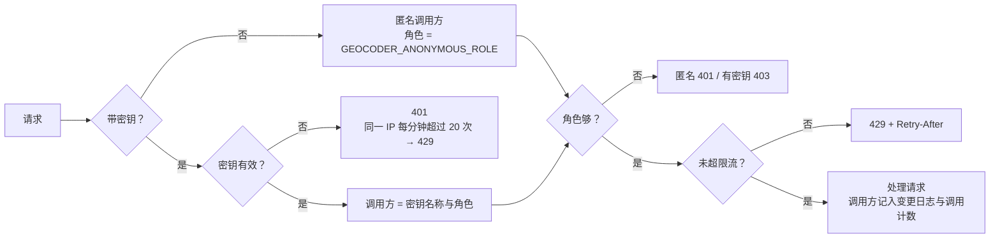

# 鉴权

服务内置一套简单的 API Key 鉴权，单独部署时也能控制谁能查、谁能写、谁能管理数据。对外暴露时仍建议放在网关之后，由网关做 TLS、IP 白名单和集中的访问日志。

## 1. 一次请求的鉴权流程



- 密钥放在 `Authorization: Bearer <key>` 或 `X-API-Key: <key>`；开启 `GEOCODER_ALLOW_QUERY_KEY=1` 后也接受 `?key=`（会进入访问日志，默认关闭）。
- 服务只保存密钥的 SHA-256，比对用常量时间比较。
- `/health` 与管理界面的静态页面 `/admin` 不需要密钥；页面里的数据都要 admin 密钥。

## 2. 角色

角色逐级包含：

| 角色 | 可用接口 |
|---|---|
| `read` | 解析、正向 / 逆向编码（含批量）、坐标转换、`/v1/meta`、MCP 查询工具 |
| `write` | read 全部 + `POST /v1/feedback` |
| `admin` | write 全部 + `/v1/admin/*`、管理界面数据、MCP 数据维护工具 |

匿名调用方的角色由 `GEOCODER_ANONYMOUS_ROLE` 决定（`none` / `read` / `write`，**不能是 admin**）：

- 没有配置任何密钥时默认 `write`，和之前的版本行为一致（查询与反馈开放，管理功能不可用）；
- 配置了密钥后默认 `none`，所有接口都要带密钥；
- 内网可以设为 `read`：查询免密钥，反馈与管理要密钥。

## 3. 配置密钥

```bash
cngeocoder keygen --name order-service --role read
# key: cng_9mJ…                          ← 交给调用方，只显示这一次
# GEOCODER_API_KEYS 条目: order-service:read:sha256:5f1e…
# GEOCODER_API_KEYS_FILE（JSON）条目: {"name": "order-service", "role": "read", "key_sha256": "5f1e…"}
```

两种写法可以同时使用：

**环境变量** `GEOCODER_API_KEYS`，逗号分隔，每项 `名称:角色:密钥`，密钥写成 `sha256:<64 位十六进制>` 时只存哈希（推荐）：

```bash
GEOCODER_API_KEYS="ops:admin:sha256:0a33…,order-service:read:sha256:5f1e…"
```

**密钥文件** `GEOCODER_API_KEYS_FILE`，JSON 数组，可单独给某个密钥配限流：

```json
[
  {"name": "ops", "role": "admin", "key_sha256": "0a33…"},
  {"name": "order-service", "role": "read", "key_sha256": "5f1e…", "rpm": 6000},
  {"name": "courier-app", "role": "write", "key_sha256": "9c2d…", "rpm": 600}
]
```

也接受每行一条 `名称:角色:密钥` 的纯文本文件（`#` 开头为注释）。

规则：名称不能重复；明文密钥至少 16 个字符；配置有误时服务启动失败并指出哪一条。

**轮换**：先加新密钥（新名称）并重启，调用方切换后删掉旧密钥再重启。

## 4. 限流

- `GEOCODER_RATE_LIMIT`：每个调用方每分钟请求上限，0 不限（默认）；密钥文件里的 `rpm` 覆盖这个值；
- 匿名调用方按客户端 IP 分别计数；
- 计数在每个 worker 进程内独立进行（不依赖 Redis），实际上限约为“配置值 × worker 数”，配置时按 worker 数折算；
- 批量接口一次请求计一次。

## 5. 配置项

| 环境变量 | 默认 | 说明 |
|---|---|---|
| `GEOCODER_API_KEYS` | 空 | `名称:角色:密钥`，逗号分隔 |
| `GEOCODER_API_KEYS_FILE` | 空 | 密钥文件（JSON 或每行一条） |
| `GEOCODER_ANONYMOUS_ROLE` | 无密钥时 `write`，有密钥时 `none` | 匿名调用方角色 |
| `GEOCODER_ALLOW_QUERY_KEY` | `0` | 是否接受 `?key=` |
| `GEOCODER_RATE_LIMIT` | `0` | 每个调用方每分钟上限 |
| `GEOCODER_PUBLIC_DOCS` | `1` | 是否开放 `/docs`、`/openapi.json`；设为 0 关闭交互文档 |
| `GEOCODER_MCP_ORIGINS` | 空 | `/mcp` 允许的浏览器 Origin（逗号分隔，`*` 不限）；默认只允许同源 |

## 6. 调用示例

```bash
curl -H "Authorization: Bearer $KEY" "http://127.0.0.1:8000/v1/geocode?address=北京朝阳望京SOHO"
curl -H "X-API-Key: $KEY" "http://127.0.0.1:8000/v1/reverse?location=116.48,39.99"
curl -H "Authorization: Bearer $KEY" http://127.0.0.1:8000/v1/auth/whoami   # 查看当前密钥的名称与角色
```

`/docs` 页面右上角的 Authorize 可以填入密钥后直接调试。

管理界面“概览”页可以看到各密钥的调用次数和被拒绝次数（本进程内统计，重启清零）。
