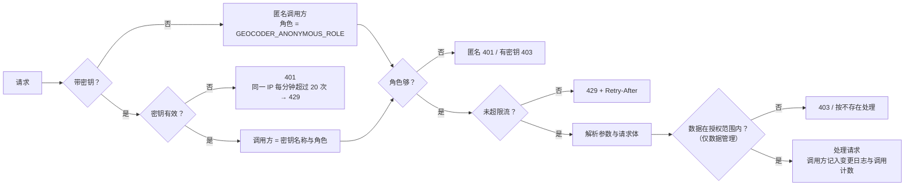

# 鉴权

服务内置一套简单的 API Key 鉴权，单独部署时也能控制谁能查、谁能写、谁能管理数据。对外暴露时仍建议放在网关之后，由网关做 TLS、IP 白名单和集中的访问日志。

## 0. 覆盖范围

| 入口 | 鉴权 | 说明 |
|---|---|---|
| 查询接口 `/v1/parse` `/v1/geocode` `/v1/reverse` `/v1/convert` `/v1/meta`（含批量） | read | 批量接口按条数计入限流 |
| 反馈 `POST /v1/feedback` | write | 反馈日志记录调用方 |
| 数据管理 `/v1/admin/*` | admin | `/v1/admin/regions` 只需 read；导出变更记录、查看密钥配置需要不限范围的 admin |
| 管理界面 `/admin` | 页面公开，数据走 `/v1/admin/*` | 用 admin 密钥登录 |
| MCP `POST /mcp` | read 起，工具按角色过滤 | 与 HTTP API 同一套密钥、数据范围、限流 |
| MCP stdio `cngeocoder mcp` | 设置 `GEOCODER_API_KEY` 时按密钥配置；否则按 `--role` | 本机子进程，见 [mcp.md](mcp.md) |
| `/v1/auth/whoami` | 任何调用方（错误密钥仍 401） | 查看自己的角色与范围 |
| `/health` | 公开 | 健康检查 |
| `/docs` `/openapi.json` `/redoc` | 公开，`GEOCODER_PUBLIC_DOCS=0` 关闭 | 只含接口说明，不含数据；每个接口标注 `x-required-role` |

每个接口都必须声明所需角色：新增接口时用 `need()` 声明，或显式加入 `api.PUBLIC_ROUTES`。`tests/test_auth_coverage.py` 会逐个检查，漏掉的接口会让测试失败。

鉴权在解析参数和请求体**之前**完成：未授权的请求只会得到 401 / 403 / 429，拿不到 422 之类的校验信息。

## 1. 一次请求的鉴权流程



- 密钥放在 `Authorization: Bearer <key>` 或 `X-API-Key: <key>`；开启 `GEOCODER_ALLOW_QUERY_KEY=1` 后也接受 `?key=`（会进入访问日志，默认关闭）。
- 服务只保存密钥的 SHA-256，比对用常量时间比较。
- `/health` 与管理界面的静态页面 `/admin` 不需要密钥；页面里的数据都要 admin 密钥。
- 所有拒绝（错误密钥、越权、超限）都记 WARNING 日志（logger `cngeocoder.auth`），含调用方名称或来源 IP，可接入日志告警；管理界面“概览”显示各密钥被拒次数。

## 2. 角色

角色逐级包含：

| 角色 | 可用接口 |
|---|---|
| `read` | 解析、正向 / 逆向编码（含批量）、坐标转换、`/v1/meta`、MCP 查询工具 |
| `write` | read 全部 + `POST /v1/feedback` |
| `admin` | write 全部 + `/v1/admin/*`、管理界面数据、MCP 数据维护工具 |

匿名调用方的角色由 `GEOCODER_ANONYMOUS_ROLE` 决定（`none` / `read` / `write`，**不能是 admin**）：

- 没有配置任何密钥时默认 `write`，和之前的版本行为一致（查询与反馈开放，管理功能不可用）；
- 配置了密钥后默认 `none`，所有接口都要带密钥；
- 内网可以设为 `read`：查询免密钥，反馈与管理要密钥。

## 2.1 数据范围（区域管理员）

admin 密钥可以只授权部分区域，用区划编码前缀表示（`11` 北京、`3101` 上海市辖区、`440305` 南山区）：

```json
{"name": "bj-ops", "role": "admin", "key_sha256": "…", "regions": ["11"]}
```

带范围的密钥：

- 要素、确认结果、待审核队列只能看到范围内的数据；范围外的要素按“不存在”处理（不泄露其存在）；
- 新增、修改、审核时，修改前和修改后都必须在范围内；把要素改到范围外会被拒绝（403）并整体回滚；无法确定所属行政区的地址也会被拒绝；
- 变更记录只能看到自己的修改；不能导出全量变更记录，看不到密钥配置和服务器文件路径；
- 管理界面、管理 API、MCP 三个入口规则相同。

## 2.2 兜底服务权限

兜底服务（天地图等）有每日配额，是所有调用方共享的外部资源。密钥文件里 `"fallback": false` 的密钥不会触发兜底：请求里 `fallback=true` 时照常返回本地结果，并带 `"fallback_permitted": false`。配置了密钥后，匿名调用方也不会触发兜底。

## 3. 配置密钥

```bash
cngeocoder keygen --name order-service --role read
# key: cng_9mJ…                          ← 交给调用方，只显示这一次
# GEOCODER_API_KEYS 条目: order-service:read:sha256:5f1e…
# GEOCODER_API_KEYS_FILE（JSON）条目: {"name": "order-service", "role": "read", "key_sha256": "5f1e…"}
```

两种写法可以同时使用：

**环境变量** `GEOCODER_API_KEYS`，逗号分隔，每项 `名称:角色:密钥`，密钥写成 `sha256:<64 位十六进制>` 时只存哈希（推荐）：

```bash
GEOCODER_API_KEYS="ops:admin:sha256:0a33…,order-service:read:sha256:5f1e…"
```

**密钥文件** `GEOCODER_API_KEYS_FILE`，JSON 数组，可单独给某个密钥配限流：

```json
[
  {"name": "ops", "role": "admin", "key_sha256": "0a33…"},
  {"name": "bj-ops", "role": "admin", "key_sha256": "77ab…", "regions": ["11"], "note": "北京数据维护"},
  {"name": "order-service", "role": "read", "key_sha256": "5f1e…", "rpm": 6000},
  {"name": "courier-app", "role": "write", "key_sha256": "9c2d…", "rpm": 600, "fallback": false}
]
```

也接受每行一条 `名称:角色:密钥` 的纯文本文件（`#` 开头为注释）。

字段：`name`、`role`、`key`（明文）或 `key_sha256`、`rpm`（每分钟上限）、`regions`（数据范围）、`fallback`（是否允许触发兜底，默认 true）、`note`（备注）。其他字段视为配置错误。

规则：名称不能重复；明文密钥至少 16 个字符；配置有误时服务启动失败并指出哪一条。

**热加载**：密钥文件修改后约 5 秒内自动生效，新增、吊销、改角色或范围都不用重启；改出错的文件不会生效，服务继续用上一次的配置并记 ERROR 日志。`GEOCODER_API_KEYS` 环境变量里的密钥需要重启才变化，经常变动的密钥建议放文件。

**轮换**：在密钥文件里加新密钥（新名称），调用方切换后删掉旧密钥。

## 4. 限流

- `GEOCODER_RATE_LIMIT`：每个调用方每分钟请求上限，0 不限（默认）；密钥文件里的 `rpm` 覆盖这个值；
- 匿名调用方按客户端 IP 分别计数；
- 计数在每个 worker 进程内独立进行（不依赖 Redis），实际上限约为“配置值 × worker 数”，配置时按 worker 数折算；
- 批量接口按条数计（1000 条的批量请求计 1000 次）；超限的批量请求整次不计数。

## 5. 配置项

| 环境变量 | 默认 | 说明 |
|---|---|---|
| `GEOCODER_API_KEYS` | 空 | `名称:角色:密钥`，逗号分隔 |
| `GEOCODER_API_KEYS_FILE` | 空 | 密钥文件（JSON 或每行一条） |
| `GEOCODER_ANONYMOUS_ROLE` | 无密钥时 `write`，有密钥时 `none` | 匿名调用方角色 |
| `GEOCODER_ALLOW_QUERY_KEY` | `0` | 是否接受 `?key=` |
| `GEOCODER_RATE_LIMIT` | `0` | 每个调用方每分钟上限 |
| `GEOCODER_PUBLIC_DOCS` | `1` | 是否开放 `/docs`、`/openapi.json`；设为 0 关闭交互文档 |
| `GEOCODER_MCP_ORIGINS` | 空 | `/mcp` 允许的浏览器 Origin（逗号分隔，`*` 不限）；默认只允许同源 |

## 6. 调用示例

```bash
curl -H "Authorization: Bearer $KEY" "http://127.0.0.1:8000/v1/geocode?address=北京朝阳望京SOHO"
curl -H "X-API-Key: $KEY" "http://127.0.0.1:8000/v1/reverse?location=116.48,39.99"
curl -H "Authorization: Bearer $KEY" http://127.0.0.1:8000/v1/auth/whoami   # 查看当前密钥的名称与角色
```

`/docs` 页面右上角的 Authorize 可以填入密钥后直接调试。

管理界面“概览”页可以看到各密钥的调用次数和被拒绝次数（本进程内统计，重启清零）。
